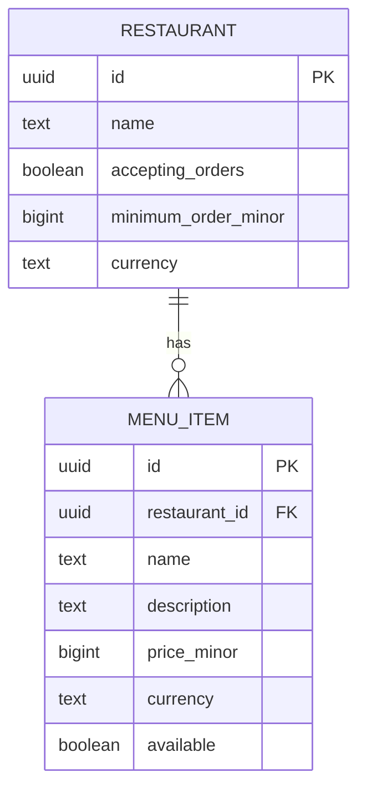

# Restaurant service

Stores restaurants and menu items in PostgreSQL. The service exposes HTTP endpoints for creating, replacing, and reading restaurants and their menus.

## Prerequisites

- Go 1.27+
- Docker with a running Docker daemon
- Make

Docker is required for the local PostgreSQL environment and for integration tests using Testcontainers.

Run the commands below from `services/restaurant`.

## Configuration

Copy the example configuration before using Make:

```bash
cp .env.example .env
```

The application reads environment variables; it does not load `.env` itself. The Makefile includes and exports `.env`. If you run Go commands without Make, export the variables in your shell.

| Variable | Purpose |
|---|---|
| `HTTP_ADDR` | HTTP listen address; default `:8080` |
| `HTTP_SHUTDOWN_TIMEOUT` | Graceful shutdown timeout; default `25s` |
| `LOGGER_LEVEL` | Log level; default `DEBUG` |
| `POSTGRES_USER` | PostgreSQL user |
| `POSTGRES_PASSWORD` | PostgreSQL password |
| `POSTGRES_DB` | PostgreSQL database |
| `POSTGRES_HOST` | PostgreSQL host |

For the service running on your machine, use `POSTGRES_HOST=localhost`. The migration container uses the Compose service name `restaurants-postgres` instead. The local database is exposed on port `5432`; make sure that port is available.

Do not commit real database credentials in `.env`.

## Run locally

Start PostgreSQL, apply migrations, then start the service:

```bash
make env-up
make migrate-up
make run
```

The server checks the database connection at startup. Migrations are not applied automatically when the server starts.

To stop the local PostgreSQL container while preserving its data:

```bash
make env-down
```

To remove the local database, including its Docker volume and stored data:

```bash
make env-cleanup
```

## Health checks

- `GET /livez` returns `200` while the HTTP process is running. It does not query PostgreSQL.
- `GET /readyz` checks PostgreSQL. It returns `200` when the database is reachable and `503` when it is unavailable.

## Database schema



One restaurant can have many menu items; each menu item belongs to one restaurant. A join table is not needed.

Names and currencies must be non-empty, and monetary amounts must be greater than zero. In addition to the primary-key indexes, an index on `menu_item.restaurant_id` supports listing a restaurant's menu. Currency consistency on writes is enforced by the SQL queries, not by table constraints.

## Migrations

Migration SQL files are stored in `migrations/migrations` and embedded into the migration binary. Goose tracks which versions have been applied.

Apply pending migrations:

```bash
make migrate-up
```

Running `migrate-up` again on an up-to-date database should make no further schema changes.

For local development, the Makefile also provides:

```bash
make migrate-down
```

`migrate-down` reverses the latest migration and may delete data. It is not part of the normal startup workflow.

In production, run forward migrations as a separate deployment step before starting the new application version. Do not run migrations implicitly from every service instance. Rolling back an application version does not automatically mean rolling back its database schema; assess schema and data compatibility separately.

After editing SQL queries in `internal/provider/postgres/query`, regenerate the sqlc code before testing:

```bash
sqlc generate
```

## Tests

Unit tests do not need the local Compose database. PostgreSQL integration tests start their own isolated database with Testcontainers and apply the migrations themselves. They require a running Docker daemon, but do not require `make env-up`.

Run all tests:

```bash
go test ./...
```

Run only the PostgreSQL repository integration test:

```bash
go test -v -count=1 ./internal/provider/postgres -run '^TestRepo$'
```

Run with the Go race detector:

```bash
go test -race ./...
```

The Makefile also provides `make test`, `make test-race`, and `make coverage`. Because it includes `.env`, create `.env` first when using these targets.

## Development commands

| Command | Purpose |
|---|---|
| `make env-up` | Start local PostgreSQL |
| `make env-down` | Stop local PostgreSQL, preserving data |
| `make env-cleanup` | Remove local PostgreSQL and its data volume |
| `make migrate-up` | Apply pending migrations |
| `make migrate-down` | Reverse the latest migration; may delete data |
| `make run` | Start the HTTP service |
| `make build` | Build the HTTP service |
| `make test` | Run all tests |
| `make test-race` | Run all tests with the race detector |
| `make coverage` | Print test coverage |
| `make fmt` | Format Go source |
| `make vet` | Run `go vet` |
| `make generate` | Regenerate mocks |
